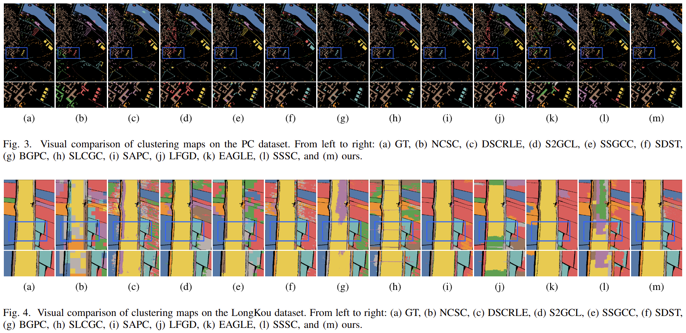

# SMEL

**Structured Multi-Evidence Learning for Hyperspectral Image Clustering**

Hyperspectral clustering is uncertain: pixels from the same land-cover class
can have very different spectra, while different classes can look similar.
This raises a simple question: besides improving the model, can we make the
evidence it learns from more useful?

SMEL explores this idea by looking at the same image from complementary
spectral and regional perspectives, then learning a common clustering decision
with a lightweight model. Our experiments show that organizing complementary
evidence can help make pixels easier to separate and deliver competitive
clustering results without relying on elaborate model architectures or a large
collection of prior-based constraints. This makes evidence construction a
useful direction to explore alongside improvements in model design.

## Visual Results



## Quick Start

The experiments use Python 3.8 and PyTorch 2.4.1. Install the dependencies
and run:

```bash
pip install -r requirements.txt
python train.py
```

By default, this runs all five datasets with five seeds and reports mean
ACC, NMI, and ARI. The compressed datasets are loaded directly from `data/`,
and results and prediction maps are saved in `results/`. A GPU is used when
available. Dataset-specific settings are provided in `config.json`.

To run one dataset, for example:

```bash
python train.py --datasets LongKou
```

The superpixel count and rank can be overridden with `--sp-seg` and `--rank`.

## Results

Mean scores over five runs per dataset using the default configuration:

| Dataset | ACC | NMI | ARI |
|---|---:|---:|---:|
| Pavia University | 0.708949 | 0.716606 | 0.570204 |
| Botswana | 0.776416 | 0.855810 | 0.719440 |
| Trento | 0.929946 | 0.868449 | 0.922976 |
| Pavia Center | 0.943314 | 0.918342 | 0.970500 |
| LongKou | 0.870331 | 0.827131 | 0.841241 |
| Mean | 0.845791 | 0.837268 | 0.804872 |

## Discussion

The broader idea is to think beyond preprocessing a single representation:
what complementary evidence could make the clustering decision more reliable?
The three evidence sources in this paper are one concrete implementation of
that idea, not a complete or universally sufficient set. Hyperspectral scenes
vary widely, and a fixed descriptor is unlikely to work equally well everywhere,
as the paper's diagnostic experiments illustrate.

There are also practical limitations. Stage-I still depends partly on the
quality of the initial K-means partition, especially when the scene has complex
cluster structures. The current evidence sources use predefined spectral and
regional constructions, which may not capture the most useful distinctions in
every scene. A lightweight model does not remove these sources of uncertainty.

Future work will explore more reliable unsupervised initialization and more
adaptive evidence construction and selection. Other evidence sources that
provide complementary information can also be considered; they need not be
limited to the descriptors used here. The goal is to identify useful, mutually
complementary cues for the scene, rather than simply add more descriptors or
assume that the present three are enough.

## Paper Correction

The published paper inadvertently retained an outdated definition of Evidence 2
that includes a regional derivative-mean term. This term was not used in the
code that produced the reported results. We apologize for this oversight.

Using the paper's notation, the corrected construction is

$$
\mathbf{h}_i = \mathcal{P}_8(\mathbf{x}_i),
\qquad
\bar{\mathbf{h}}_{s(i)} = \frac{1}{|S_{s(i)}|}
\sum_{j\in S_{s(i)}}\mathbf{h}_j.
$$

$$
\mathbf{x}_i^{(2)} =
\left[\mathrm{PCA}_{20}(\mathbf{x}_i),\;
\mathcal{P}_8(\mathbf{x}_i),\;
\mathcal{P}_8(\Delta\mathbf{x}_i),\;
\bar{\mathbf{h}}_{s(i)}\right]\in\mathbb{R}^{44}.
$$

Symbol meanings are as defined in the original paper. With the default settings,
Evidence 2 has **44 dimensions, not 52**. This correction concerns the written
definition only; the model and experimental results are unchanged.
